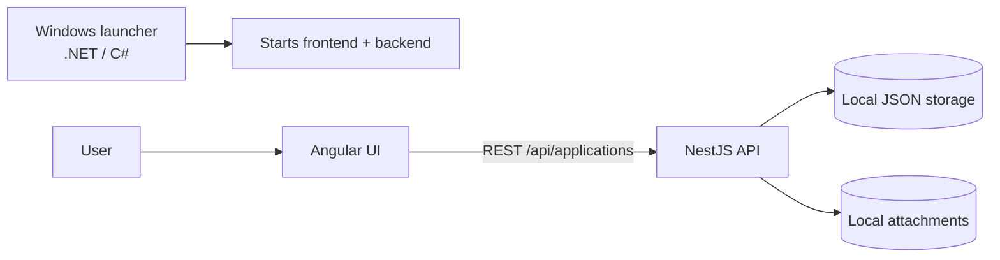

# Bewerbungskontroller — Job Application Tracker

> This repository provides a public overview of a privately maintained software project. The source code is not publicly available.

A local desktop tool for keeping track of job applications: status, custom fields, attachments and bulk import — started with a single click on Windows.

---

## Project Overview

| | |
|---|---|
| **Type** | Local full-stack tool (Windows) |
| **Team** | Solo project |
| **Use** | Personal productivity tool, used for my own applications |

## Problem & Solution

**Problem:** Spreadsheets get messy when tracking many applications with different stages, documents and notes.

**Solution:** A small Angular + NestJS app that stores everything locally, supports custom columns and file attachments, and starts from a single Windows executable.

## Key Features

- Application list with sorting, search and status filter
- **Custom columns**; show / hide standard columns
- File attachments per application (upload / download, size-limited)
- **JSON import** with German and English field aliases (e.g. for AI-generated data)
- Dark mode
- One-click start via a Windows launcher

## Technology Stack

| Layer | Technologies |
|---|---|
| Frontend | Angular 21, TypeScript |
| Backend | NestJS 11 (REST) |
| Storage | Local JSON file and file uploads — no external database |
| Launcher | .NET single-file Windows executable (C#) |

## System Architecture

## My Role & Contributions

Sole developer:

- REST API with CRUD, custom columns, import and attachment endpoints
- Angular UI with filtering, sorting and theming
- Flexible import mapping for differently structured data
- C# launcher packaged as a single-file executable

## Development Process

Built for my own use and imported into Git as a finished tool; personal application data is kept outside the repository.

See [DEVELOPMENT_LOG.md](DEVELOPMENT_LOG.md).

## Project Status

**Completed and in personal use.**

## Screenshots

Not published, because the tool contains personal application data.

## Technical Challenges & Solutions

| Challenge | Solution |
|---|---|
| Importing data with inconsistent field names | Alias mapping for German and English field names |
| Starting two dev servers is inconvenient | Single-file .NET launcher |
| Keeping private data out of version control | Data and upload folders excluded from Git |

## Skills Demonstrated

`Angular` `TypeScript` `NestJS` `REST API design` `File uploads` `Data import / mapping` `C# / .NET` `Desktop tooling`

---

### About the source code

The original repository is private. This showcase contains documentation only.
